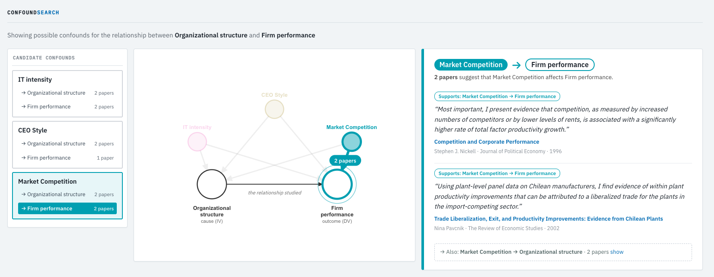

# ConfoundSearch

Supporting code for our Organization Science submission: ConfoundSearch. Please see our submission documents for more.




*The interface showing possible confounds for organizational structure and firm performance. For an interactive demo, download
[`assets/known_confounds.html`](assets/known_confounds.html) and open it in a browser.*

## Quick start

```bash
pip install confoundsearch        # 1. install (Python 3.8+)
confoundsearch demo               # 2. run a demo
```

ConfoundSearch has latency and requires API keys. The demo gives you a sense of how it works before a full setup.  `confoundsearch demo` shows a full run from start to finish and opens the result, for the independent variable `organizational structure` and the dependent variable `firm performance`. 
For this one query, the package ships all of the data queries and model queries already cached and ready to go. 
This means that it runs in about a second without any setup. We recommend trying out the demo to start and then proceeding with a full setup.

### Full setup

When you are ready to run your own queries:

```bash
confoundsearch setup              # 3. save your keys in a .env file (language model, Semantic Scholar)
confoundsearch install-skill      # 4. optional: add the Claude skill

# A run can be slow; we are working to reduce latency. We suggest a tmux/screen session or side terminal.
# 5A. in Claude Code:  /confoundsearch iv="Organizational structure" dv="Firm performance"
# 5B. or run the package directly (it searches every source you have set up):
confoundsearch run --model qwen/qwen3-max \
  --iv "Organizational structure" --dv "Firm performance" \
  --max-budget 1.00 --out results/org.html

confoundsearch review --in results/org.html     # 6. open the interface: the confounds as a causal graph
```

## How to setup API keys

`confoundsearch setup` asks for API keys and saves them in a file called `.env` in the folder where you run the code (if `.env` files are
unfamiliar, [this page](https://github.com/theskumar/python-dotenv#readme) explains the idea). Your keys stay on your computer. Some keys are necessary, others are just nice to have:

| Key | The service, and where to get a key | Why |
| --- | --- | --- |
| `OPENROUTER_API_KEY` or `OPENAI_API_KEY`: **required** for your own questions (the example works without) | [OpenRouter](https://openrouter.ai/keys) sells access to hundreds of models from many providers behind one key; [OpenAI](https://platform.openai.com/api-keys): [here is how to get started with the OpenAI API](https://platform.openai.com/docs/quickstart) if that is unfamiliar | The agent reads each paper's abstract and judges whether it supports a causal claim, so every run makes model calls. Any OpenAI-compatible model works (`--model`). |
| `S2_KEY`: strongly recommended | [Semantic Scholar](https://www.semanticscholar.org/product/api) is a free academic search index run by the Allen Institute for AI; the key is free | Everything runs faster. Without a key you share a rate limit with every anonymous user, so searches get refused (HTTP 429) and runs slow down or stop early. |
| `OPENALEX_API_KEY` or `OPENALEX_EMAIL`: optional | [OpenAlex](https://openalex.org/settings/api) is a free, open index of scholarly papers run by the nonprofit OurResearch; the key needs a free account | Runs faster. A key or an email puts you in OpenAlex's faster, more reliable pool, so searches finish sooner and fewer fail. |
| `OPENAI_API_KEY`: optional | An [OpenAI key](https://platform.openai.com/api-keys); its embedding models turn text into vectors, so similar meanings sit close together | Finds related keywords by meaning (say, "head count" for "firm size"), even for a phrase ConfoundSearch has never seen: an OpenAI model turns your phrase into numbers that can be compared. Set it even if the agent uses a different model. |

Not a key: the [ConfoundSearch service](https://confoundsearch.org) is on by default and searches papers and keyword vectors for
you. Your search terms go to it; `--api off` (or `CONFOUNDSEARCH_API=off`) turns it off.

A run usually costs under $1 in model fees. `--max-budget USD` stops it at about that cost, keeping what it found.

## Data directory

As it searches, ConfoundSearch downloads papers and saves them, and the language model's answers, in a *data directory*, a folder on your computer,
so the same search is never made twice and the same question is never paid for twice: reruns are faster, use no rate limit and return the same papers. This is a [cache](https://en.wikipedia.org/wiki/Cache_(computing)), a common
pattern: [Transformers](https://huggingface.co/docs/transformers) keeps models in a [folder set by `HF_HOME`](https://huggingface.co/docs/hub/local-cache),
and [pip](https://pip.pypa.io/en/stable/topics/caching/) does the same with its downloads. We use one small [SQLite](https://www.sqlite.org/about.html)
file per question (pair of independent and dependent variable), so studies never mix, and each paper is stored once.

**Where.** By default in your [temporary folder](https://en.wikipedia.org/wiki/Temporary_folder) (`/tmp/confoundsearch-<you>` on Linux), which your
computer clears from time to time (Mac and Linux: after a restart or a few days; Windows: only if its automatic clean-up is on). This directory can get flushed.

**To keep it.** Set the [environment variable](https://en.wikipedia.org/wiki/Environment_variable) `CONFOUNDSEARCH_CACHE`, for example
`CONFOUNDSEARCH_CACHE=~/confoundsearch-data`. `confoundsearch setup` asks for it and saves it in `.env`; `--cache-dir` sets it for one run.

**To empty it.** `confoundsearch flush` (everything) or `confoundsearch flush --iv "..." --dv "..."` (one question). `--no-cache` ignores it for one run. The example
question starts pre-warmed: the first time you run it, its saved searches and model answers are copied here (emptying it just means they are copied again next time).

**To keep a permanent record.** What matters is the result of a run, not the downloaded papers. `run` saves it where you point `--out`: the page
(`results/org.html`) and, next to it, an audit trail (`results/org.audit.jsonl`). `confoundsearch audit results/org.audit.jsonl > report.md` checks that
the trail is intact and prints a readable report of each confound, its supporting papers (with links) and which search found them.

## What's in this code base?

The application is divided into four layers, as described in the technical appendix. Each is one directory, and if you are
curious about any of them, feel free to poke around:

- **Data** ([`confoundsearch/data/`](confoundsearch/data)): where papers come from (hosted Elasticsearch, Semantic Scholar, OpenAlex, or your file).
- **Logic** ([`confoundsearch/logic/`](confoundsearch/logic)): the Markov decision process (graph, moves, reward, policy) and the audit log.
- **Language model** ([`confoundsearch/model/`](confoundsearch/model)): any OpenAI-compatible model, including OpenRouter.
- **Interface** ([`confoundsearch/interface/`](confoundsearch/interface)): the web app, command line, JSON output and agent skill.

## Other key directories

- [`tests/`](tests): the unit tests, with 100% branch coverage. They also enforce the layer boundaries described in the technical appendix.
- [`devops/`](devops): scripts for releasing, checking the package on every Python version, and publishing the anonymous review copy.
- [`evals/`](evals): code and data for the pilot studies described in the technical appendix.
